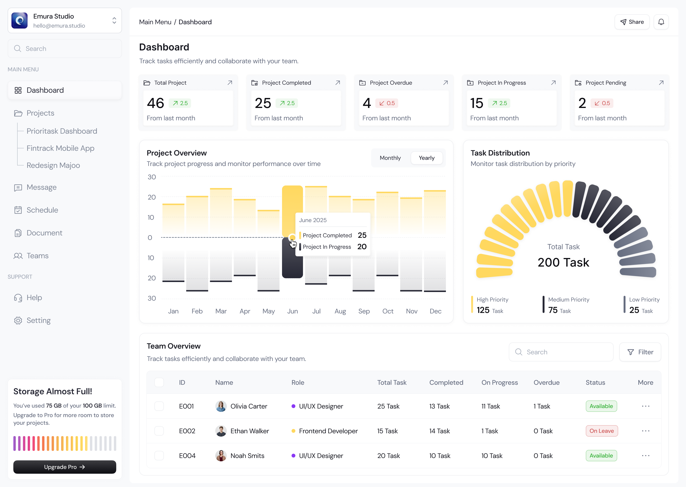

# Dentis Dashboard - Portal Manajemen & Operasional Klinik Gigi

Dashboard internal klinik gigi modern **Dentis** yang dirancang untuk mengelola operasional harian, manajemen reservasi pasien & web leads, database rekam medis, jadwal praktik dokter spesialis, analitik keuangan, serta sistem CMS terintegrasi untuk website klinik.



## Fitur Utama

- **Overview & Operasional**: Monitoring antrean pasien harian, ketersediaan dokter on-duty, statistik okupansi dental unit, dan ringkasan operasional real-time.
- **Manajemen Reservasi & Leads**: Pelacakan status reservasi pasien (*Confirmed*, *Pending*, *Selesai*, *Dibatalkan*), filter per dokter, integrasi konfirmasi WhatsApp, dan pencatatan pembayaran (DP / Lunas / Kasir).
- **Database Pasien & Rekam Medis (EMR)**: Riwayat kunjungan klinis, catatan diagnosis dokter, riwayat tindakan perawatan gigi, dan rekap biaya tindakan pasien.
- **Tim Dokter Spesialis & Shift**: Kalender shift praktik mingguan (Pagi, Siang, Malam), manajemen status kehadiran (*On-Duty*, *Standby*, *Off Day*, *Cuti*), dan fitur penukaran shift kerja antar-rekan sejawat.
- **Laporan & Analitik Keuangan**: Pelacakan omzet pendapatan klinik harian/bulanan, breakdown metode pembayaran (QRIS, Kasir/Tunai, Transfer), dan volume tindakan terbanyak.
- **CMS Website Terintegrasi**: Pengaturan copywriting hero section, katalog layanan web, galeri hasil perawatan (*before-after*), testimoni pasien, FAQ, hingga banner promo dan info kontak klinik.
- **Multi-Branch Support**: Pengalihan cabang klinik (Senopati, Dharmawangsa, dll.) dengan sinkronisasi data instan.

## Tech Stack

- **Framework**: [Next.js](https://nextjs.org/) (App Router)
- **Language**: [TypeScript](https://www.typescriptlang.org/)
- **UI & Styling**: [Tailwind CSS](https://tailwindcss.com/)
- **Icons**: [Lucide React](https://lucide.dev/)
- **State Management**: React Context (`DentisContext`) dengan persistensi `localStorage`

## Memulai (Getting Started)

1. Clone repositori:
   ```bash
   git clone https://github.com/intandhamayanti/dentis-dashboard.git
   cd dentis-dashboard
   ```

2. Instal dependensi:
   ```bash
   npm install
   ```

3. Jalankan development server:
   ```bash
   npm run dev
   ```

4. Buka [http://localhost:3000](http://localhost:3000) pada browser Anda.
